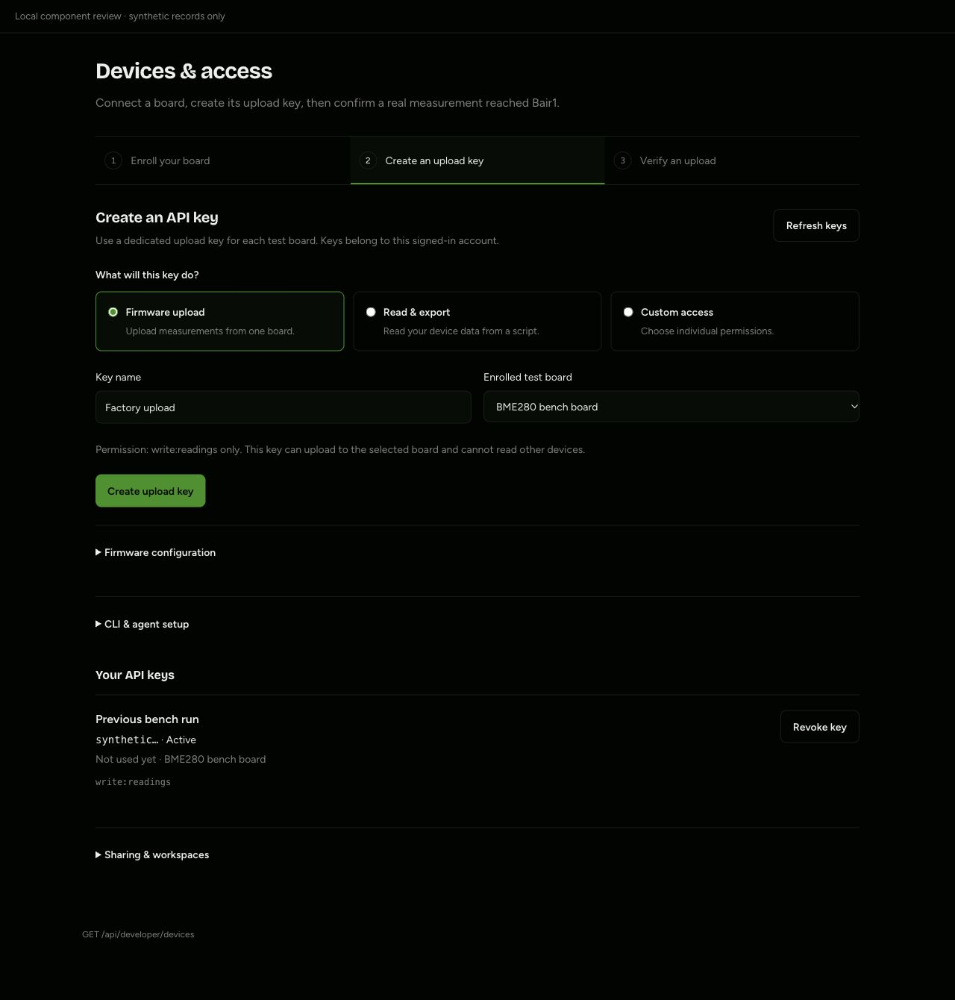
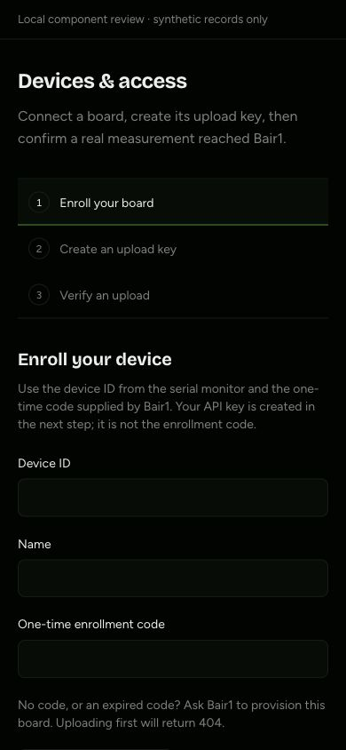

# Manufacturer setup verification — 5 November 2026

The setup flow was reviewed using the installed Impeccable Operate/onboarding guidance and [Emil Kowalski's design engineering skill](https://github.com/emilkowalski/skills/tree/main/skills/emil-design-eng). The [official Taste skill](https://github.com/Leonxlnx/taste-skill) was located and reviewed; its current marketing-page workflow was not applied to this authenticated task interface. Existing Bair1 colors, typography and workspace permissions were preserved. Impeccable's context launcher was unavailable (permission denied); PRODUCT.md and the actual implementation supplied the context.

## Automated checks

- Production build and TypeScript: pass.
- Lint: zero errors, 24 pre-existing warnings.
- Offline tests: 36 pass.
- Real local DynamoDB access/enrollment/share/race tests: 12 pass.
- HTTP/database ingestion tests: 13 pass, including an unenrolled upload returning actionable 404 without creating a registry record or storing a reading.
- Local snapshot restore regression: one pass.
- Actual native firmware serializer and stored/duplicate/conflict acknowledgment assertions: pass.
- Real production-build HTTP guards: 13 pass.

That is 75 test cases and HTTP checks plus the native firmware checks. They verify software contracts with synthetic data; they are not factory sign-off or proof of physical device behavior.

## Browser verification

A temporary, uncommitted loopback-only harness rendered the real ConnectionView, AccessView and DeveloperView with synthetic fetch responses. It was not an authentication bypass or a route in the application build. Checked at 1280px and in a 390px responsive frame. The 390px document's client and scroll widths were both 390px. The browser viewport override did not take effect, so the narrow review used an iframe with a real 390px CSS viewport; it was not a physical mobile-device test.

Observed:

- Empty enrollment guidance, disabled firmware key creation before enrollment, then a successful enrollment-to-key transition.
- Firmware key request included write:readings and the selected device restriction. Returning from custom permissions removed a custom read permission.
- One-time key value was masked, could be permanently hidden, and revocation required a separate confirmation action.
- Last-upload verification distinguished a recent receipt, an old receipt, no reading and a service error. A reported temperature of zero remained visible as 0 °C. Server receipt times are labeled UTC.
- Sharing/workspace controls remained available separately from device connection steps.

Screenshots below contain synthetic records only; no real credentials or device identifiers.

## Operational boundary

The manufacturer must still complete the real-board procedure in TESTING.md. A configuration file and login do not prove device enrollment. This PR does not auto-register uploads, transfer device ownership, grant customer access, activate paid services, install firmware or perform physical tests. The original 404 remains expected until a platform-issued one-time enrollment code is claimed by the account owning the firmware key.
