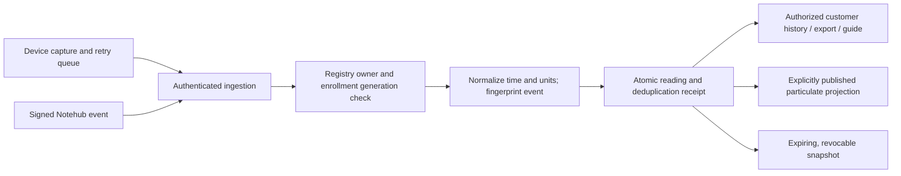

# Measurement data and customer views

This branch is a review candidate, not a hosted release. CSV exports use the
43-field Reading projection shared with GraphQL; paged JSON includes schemaVersion
2. Existing REST arrays remain compatible, with limit/truncation metadata. Unknown
values are null, including AQI; genuine zero stays zero. Text exported to CSV is
quoted and spreadsheet formulas are neutralized. Raw JSON is never an export field.

| Fields | Meaning / unit | Privacy |
| --- | --- | --- |
| deviceId | Physical/public application identifier, never the namespaced storage key | Private or deliberate public feed |
| timestamp, capturedAt, receivedAt, clockQuality | Effective measurement time, reported capture time, server receipt and clock provenance | Feed safe |
| pm1, pm25, pm4, pm10 | Particulate mass, µg/m³ | Feed safe |
| aqi | Explicit device-reported index; no conversion from gas/ADC, calibration unverified | Feed safe |
| temperature, humidity, pressure | °C, % RH, hPa | Private / revocable snapshot |
| altitudeMeters | Barometric estimate, m; not surveyed elevation | Private |
| adcD3Raw, adcD2Raw | ADC counts | Private |
| adcD3PinVoltage, adcD2PinVoltage | Measured/calculated pin voltage, V | Private |
| adcD3InputVoltage, adcD2InputVoltage | Divider-based input estimate, V; hardware calibration unverified | Private |
| gasRaw, gasVoltage, airState | Raw sensor count, V and device-reported classification; not calibrated AQI | Private |
| dhtTemp, dhtHum | Secondary sensor °C / % RH | Private |
| accelX, accelY, accelZ, gyroX, gyroY, gyroZ | Firmware-native motion channels; units require firmware-specific confirmation | Private |
| batteryVoltage, batteryLevel | V and reported charge %; no invented estimate | Private / snapshot voltage |
| lat, lng, locationAccuracy | Coordinates and estimated accuracy radius, m | Private; omitted from feed and snapshot |
| sensorModel, board, firmwareVersion, transport | Device/source provenance | Private |
| rssi, uptimeMs, sample | dBm, ms and device sample count | Private |

## Data movement

A capture timestamp and server receipt are different observations. Successful HTTP
polling never makes old measurements live. Sparse Notecard events update each
measurement with its own observation timestamp; a heartbeat does not refresh them.
Unknown Notehub pressure units remain unavailable; explicit Pa is converted to hPa.
Firmware adds schemaVersion/pressureUnit metadata but has not been flashed.

Device selection invalidates previous measurement/history/guide state. The map is
scoped to the selected device. The overview exposes reported environmental/ADC/PM
capabilities, capture and receipt provenance. History loads 200 rows per request,
up to 10,000 preview rows, with explicit continuation/end labels. CSV contains up
to 10,000 records; a response header warns of possible truncation. Use smaller
ranges or cursor pagination for a complete larger export. Ranges are bounded to
14 days; DynamoDB TTL cleanup timing is not an availability guarantee.

Network MACs/SSIDs and cell identifiers are transient geolocation inputs and are
removed before new raw measurement storage. Only allowed Wi-Fi properties go to
Google. considerIp:false prevents resolving the server's IP as the device. Results
must have finite in-range coordinates and a positive accuracy radius <=10 km.
Existing stored payloads are not rewritten. Official request semantics:
https://developers.google.com/maps/documentation/geolocation/requests-geolocation

Google/LAQN context and model-generated guidance are separate sources, not sensor
readings. Public pages no longer load device API keys or expose hardware controls.
Public feed publication still requires both registry opt-in and platform allowlist.

## Evidence

24 baseline/contract tests plus the geolocation regression, eight real DynamoDB
Local access/history tests and eleven real HTTP/DB ingestion tests cover the
changes. The native firmware serializer and reply parser execute on synthetic
fixtures. Desktop (1280 px) and mobile (390 px) synthetic browser review verified
pressure units, zero/missing values, stale versus connection time, device switching,
empty state, history loading, role-limited navigation and access forms. The local
fixture and mocked authentication are removed before commit. No live user/device,
paid provider, enrollment, share or workspace action was executed during UI review.
Hosted Auth0/two-account acceptance, precise motion units and hardware calibration
remain rollout gates; local success does not establish production readiness.
